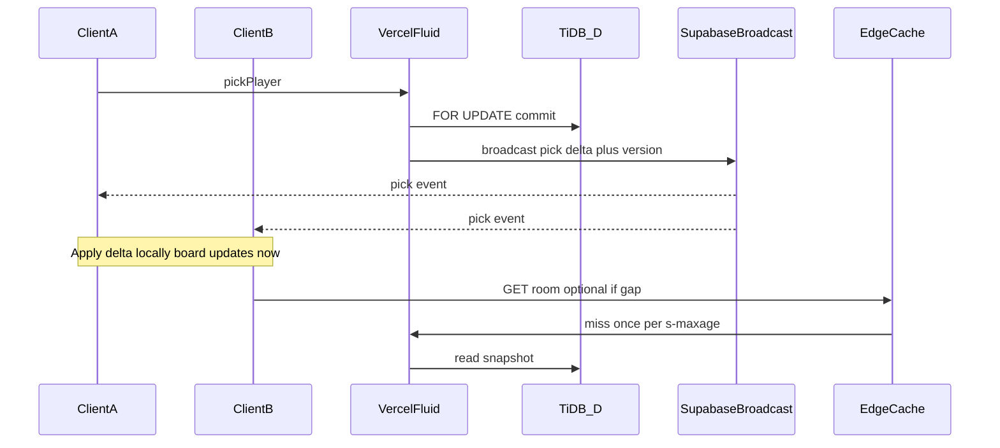
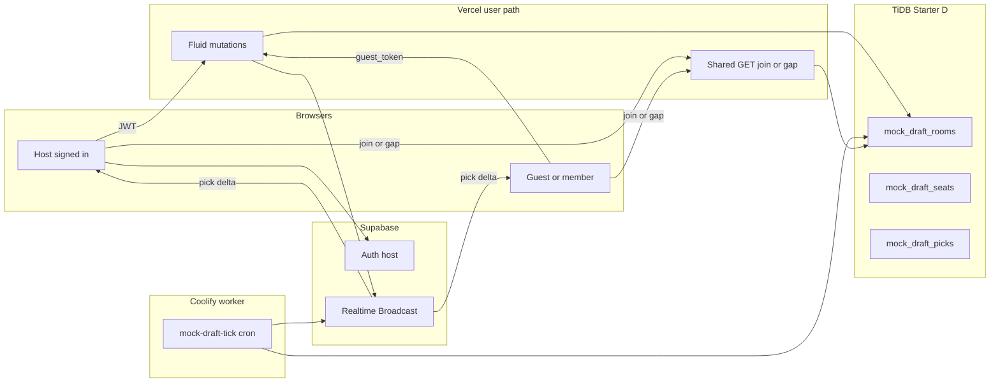

# Multiplayer Mock Draft Lobbies — Implementation Plan

**Decisions locked**

| Decision | Choice |
| --- | --- |
| Product | **Standalone practice rooms** — friends draft together; AI fills empty seats. Not native-league season drafts. |
| Create | **Logged-in host only** (Supabase auth) |
| Join | **Anyone with the room code** — signed-in users claim a seat with `user_id`; guests get a signed `guest_token` bound to that seat |
| Solo simulator | Keep `/mock-draft/setup` → `/mock-draft` as-is (client-only AI). Multiplayer is a parallel path. |
| Native live snake | **Out of scope.** Remains deferred in [`native-leagues-plan.md`](native-leagues-plan.md) Phase 2. Do not hitch mock rooms to `native_*` tables or `/league/$linkId/draft`. |
| Live sync | **Push-first:** Supabase **Realtime Broadcast** on each pick/lobby change; clients apply deltas (or one shared CDN GET). **Not** 1–2s polling. |
| Data home | **Dedicated TiDB Starter D** = source of truth for rooms/picks; Supabase = Auth + Realtime fan-out only (no lobby rows in Postgres). |
| Completed boards | Freeze a compact JSON snapshot on complete; retain **7–14 days**; share via opaque token; CSV/JSON export client-side from that snapshot. |
| Shared room reads | **Room read key** + `GET /api/mock-draft/room/$id?k=` with **`public, s-maxage=1–2`** so all seats share one edge cache. |
| Vercel (user path) | UI + Fluid **mutations only** (create/join/pick/host) + rare shared GET on join/gap. |
| Worker (Coolify) | **All mock cron / AI timeout / expiry** (`/api/cron/mock-draft-tick`) and prefer other `/api/cron/*` here — see §0.4. Goal: mocks **off Vercel for the most part**. |
| Safety net | Resync GET on **reconnect / tab focus / version gap** only while Realtime connected. |
| Pick timer | **One duration for every seat** (host `pick_time_limit_sec`). Shared wall-clock `pick_deadline_at` — all clients show the same remaining time. |
| Realtime peak 200 | **Accepted** — product will not target >200 concurrent mock tabs. |

Mobile already labels the entry point **“Mock Draft Lobby”** ([`MobileMockDraftCard`](../src/components/mobile/MobileHomeSections.tsx)) but it only links to solo setup. This plan makes that label real.

---

## 0. Where to host lobbies (options ranked)

TiDB Cloud allows **up to 5 free Starter instances** per org, each with its own **~50M RU/mo + 5 GiB** pool. That is the lever for “mocks don’t steal research RUs” — not moving live traffic onto Supabase.

### Ranked options

| Rank | Option | Live lobby + picks | Separate free pool? | Verdict |
| --- | --- | --- | --- | --- |
| **1 (recommended)** | **Dedicated TiDB Starter “D – Mocks”** | `mock_draft_*` only | **Yes** — own 50M RU | Best isolation; same code patterns as native; no auth-DB coupling |
| **2** | TiDB cluster **C with native** (`native_*` + `mock_draft_*`) | Shared instance | Shared 50M with native seasons | Fine if native traffic is still low; simpler ops (one extra cluster, not two) |
| **3** | Stay on **current** TiDB (research/synced) | Same instance as warehouse | No | OK for a quiet beta only; mocks compete with research RUs |
| **4** | **Upstash Redis / Vercel KV** live + TiDB snapshot | Ephemeral KV | Depends on KV free tier | Excellent for hot state later; new vendor + ops; not required for v1 |
| **Avoid** | **Supabase Postgres** for lobby/picks | Auth project DB | No — shares 500 MB / 5 GB egress / pause with Auth | Draft polls can starve or pause the whole site |
| **Use as fan-out only** | **Supabase Realtime Broadcast** | Push pick/lobby events | 200 peak conns / 2M msgs/mo | **Yes for live UX** — never store picks in Postgres |

### Split of responsibilities (locked)

| Layer | Store |
| --- | --- |
| Sign-in / host identity | **Supabase Auth** |
| Live seats, clock, picks, join codes | **TiDB D** (authoritative) |
| Instant “everyone updates on pick” | **Supabase Realtime Broadcast** (ephemeral; channel secret = room read key) |
| Optional “My saved mocks” list | Thin Supabase **or** TiDB index (low churn) |
| Coalesced snapshot GET | Vercel `/api/mock-draft/room/$id?k=` + edge `s-maxage` |

Do **not** put lobby/pick **rows** in Supabase Postgres (pause/egress). Do **use** Realtime as a megaphone after TiDB commits.

### Recommended path

1. **Provision TiDB Starter D** for mocks (see §0.1).
2. **Push-first sync** (§0.2): Broadcast on pick; shared CDN GET when a full refresh is needed; slow safety poll only.
3. Guests never need Supabase Auth; they still subscribe to Realtime with the room read key (public channel name derived from secret).
4. Revisit Redis/KV only if TiDB D or Realtime caps hurt under real load.

**Org quota note:** 5 free Starters total. Suggested map: A research · B synced/warehouse · C native · **D mocks** · (one spare).

### 0.1 Provisioning TiDB cluster D (mocks)

| Step | Detail |
| --- | --- |
| Create | TiDB Cloud → new **Starter** instance (MySQL-compatible), region near Vercel |
| Schema | Empty DB e.g. `league-office-mocks`; only `mock_draft_*` tables |
| Env | `DATABASE_URL_MOCK` (or `TIDB_MOCK_DATABASE_URL`) in Vercel + local `.env` — **never** reuse research `DATABASE_URL` |
| Code | Second pool helper beside [`tidb.ts`](../src/lib/tidb.ts): `mockTidbConfigured` / `mockTidbExecute`; migrate via admin path scoped to mock URL |
| Migrate | Extend [`tidb-migrate.server.ts`](../src/lib/tidb-migrate.server.ts) (or sibling) with `mock-draft-ddl.server.ts` statements against the mock URL only |
| Monitor | TiDB console RU chart for D alone; alert if mocks approach ~50% of monthly free RU while research is healthy |

**Important:** Cluster D isolates TiDB RUs only. **Live UX must not 1–2s poll Vercel** — use push + shared edge reads (§0.2).

### 0.2 Live sync — share the room, push on pick (min limits)

**Goal:** everyone sees a pick **immediately**, while Vercel invocations stay near “mutations + rare refresh,” not tens of thousands of polls.



#### Mechanisms (all three together)

| Mechanism | Role |
| --- | --- |
| **1. Realtime Broadcast** | After every successful TiDB write (human pick, AI/cron pick, lobby seat change, pause/start), server sends a small event on channel `mock:{roomId}:{readKey}`: `{ v, type, pick?, deadlineAt?, status? }`. Clients patch local state **instantly**. |
| **2. Shared room read key + CDN** | `read_key` minted at create; given to every joiner. `GET /api/mock-draft/room/$id?k=$readKey` uses `Cache-Control: public, s-maxage=1–2, stale-while-revalidate=1`. All seats share **one** edge object — not 10 private Function hits. |
| **3. Resync GET (not a live poll)** | On join, reconnect, tab focus, or `v` gap only. Skip periodic polling while the Realtime channel is connected. |

**Payload rule:** prefer **deltas** in Broadcast (under Realtime’s ~256 KB cap), including `deadlineAt` + `serverNow` so timers stay aligned without a GET. Full board only via shared GET on join/gap.

**Auth rule:** mutation still needs seat guest token / JWT. Read GET only needs `readKey` (anyone with the link can spectate — acceptable for a practice room; rotate key if host kicks everyone).

**Pick timer (same for everyone):** Host sets one `pick_time_limit_sec` (or None) for the room. After each pick commits, server sets `pick_deadline_at = now + limit`. **Every client** countdowns from that same timestamp (correct with `serverNow` skew). Whose turn it is does **not** change the duration — seat 1 and seat 10 both get e.g. 60s. Pause freezes / clears deadline; resume sets a fresh deadline. No per-second server traffic for the clock UI.

### 0.2.1 Further Vercel savings (platforms we already have)

Push + shared CDN already removes almost all poll burn. Extra cuts using **current** stack only:

| Lever | Platform | What it saves |
| --- | --- | --- |
| **No safety poll while Realtime connected** | Supabase Realtime | Drops the ~2.4k browser GETs/room-hour from §0.3; Vercel origin hits near **mutations + join + cron only** (~300/room) |
| **Rich Broadcast deltas** (`pick`, `deadlineAt`, seats) | Supabase Realtime | Avoid mid-draft shared GETs entirely except gaps |
| **Coolify worker for mock-draft-tick (locked for rollout)** | Actions → worker `APP_URL` / `CRON_APP_URL` | Autopick/AI/expiry **0 Hobby** — §0.4 |
| **Until worker is live: cron ≤1/min on Vercel as temporary bridge** | Actions + Vercel | Ship UX first; flip URL when Coolify is up |
| **Completed recap: client already has board** | Browser | Recap UI from in-memory state; optional one cached GET only for share-link visitors who weren’t in the room |
| **Share-link recap long cache** | Vercel `s-maxage` on `/recap/$shareId` | Repeat openers don’t re-hit TiDB/Fluid |
| **Keep mutations as the only Fluid `createServerFn`s** | Vercel | Reads stay Nitro API routes (or edge cache hits) |
| **ssr: false + no intent-preload of room APIs** | Router | No accidental SSR/Fluid storms on navigate |
| **Solo mock stays 100% client** | Existing `/mock-draft` | Zero Vercel/TiDB for single-player practice |

**Not worth it for mocks (same platforms):** putting pick writes on Supabase Edge Functions (splits SoT, doesn’t help TiDB locks); publishing live boards to `snap-cdn` (public orphan branch — wrong privacy model).

#### What we are not doing

- 1–2s Fluid or API polling as the live path  
- Storing picks in Supabase Postgres  
- Per-user `Authorization` on the cached GET (that defeats shared `s-maxage`)  
- Autopick side effects on GET  

#### Hobby + Supabase Free impact (push-first)

| Limit | How mocks use it |
| --- | --- |
| Vercel invocations | create/join/pick/host + cron + rare safety/CDN-miss GETs |
| Vercel Active CPU | Mutation + occasional snapshot serialize |
| Supabase Realtime connections | **1 per open client tab** (Free peak **200**) |
| Supabase Realtime messages | ~1 event × N subscribers per pick (Free **2M/mo**) |
| TiDB D RUs | Writes per pick + rare full reads |

### 0.3 Worked example — 10 humans, 2 hours (push-first)

Assumptions: 10 visible humans, 15 rounds (**150 picks**), Broadcast on each pick (with `deadlineAt`), **no periodic safety poll** while Realtime connected, shared GET only on join/gap.

| Traffic | Count | Notes |
| --- | --- | --- |
| Pick POSTs | **150** | Fluid |
| Setup POSTs | **11** | create/joins/start |
| Cron ticks | **~120** | ≤1/min global; AI/timeout + Broadcast |
| Broadcast events | **~150** | ~**1.5k** deliveries to 10 clients |
| Shared GETs | **~10–30** | join + rare gap/focus |
| **Vercel invocations (typical)** | **~300–400** | vs ~36k naive poll |

#### Vs monthly free limits (this room)

| Limit | Free / mo | This draft | Share |
| --- | --- | --- | --- |
| Vercel invocations | 1M | **~0.3–0.4k** | **~0.03–0.04%** |
| Vercel Active CPU | 4 hrs | Mutations + cron | **≪1%** |
| Supabase Realtime messages | 2M | **~1.5k** | **~0.08%** |
| Supabase Realtime peak conns | 200 | **10** | Fine — we will not exceed 200 concurrent tabs |
| TiDB D RUs | 50M | ~150 writes + few reads | **≪1%** |

**Remaining Vercel on mocks after Coolify:** pick/join/create Fluid + join/gap GETs only (~150–200 invocations per 10×2h room). Realtime peak 200 is an accepted ceiling.

### 0.4 Coolify worker — get mocks off Vercel (most of the way)

Full infra checklist lives in [`free-tier-and-ux-scale-plan.md`](free-tier-and-ux-scale-plan.md) Phase 1. Mock-specific lock-in:

| Piece | Where it runs at rollout |
| --- | --- |
| Host/join/pick/pause UI + mutations | **Vercel** (unavoidable user path) |
| Shared room/recap GET | **Vercel** edge cache (rare) |
| `mock-draft-tick` (deadline autopick, AI seats, TTL purge, Broadcast after AI) | **Coolify worker** |
| GitHub Actions schedule | Stays on Actions; `CRON_APP_URL` → worker |
| Solo `/mock-draft` | **Browser only** (already) |

**Rollout sequence:** implement tick route so it runs on **either** host → ship multiplayer with Actions hitting Vercel briefly if needed → **you** stand up Coolify + DNS + secrets → point `CRON_APP_URL` at worker → confirm Vercel no longer receives mock ticks.

**You:** VPS, Coolify, DNS `worker.…`, env paste, GitHub secret. **Agent:** tick + Broadcast code, `CRON_APP_URL` workflow support, env checklist, verify `authorizeCronRequest`.

#### Compare sync strategies

| Strategy | Vercel invocations (10×2h) | Instant on pick? |
| --- | --- | --- |
| Naive 2s poll each client | ~36k | Lag up to 2s |
| Shared CDN + 2s poll | ~3.6k | Lag up to 2s |
| Push + 30s safety poll | ~0.5–0.8k | Yes |
| **Push + join/gap GET only (locked)** | **~0.3–0.4k** | **Yes** |

---

## 1. Current state

| Surface | Route | Authority | Notes |
| --- | --- | --- | --- |
| Solo Mock Draft | `/mock-draft/setup` → `/mock-draft` | Browser `useState` + `sessionStorage` config | AI loop + pick clock in [`mock-draft.tsx`](../src/routes/mock-draft.tsx); math in [`draft.ts`](../src/lib/draft.ts); AI in [`mock-ai.ts`](../src/lib/mock-ai.ts) |
| War Room | `/draft` | `localStorage` via [`use-draft.ts`](../src/hooks/use-draft.ts) | Manual board; no clock / AI |
| Native draft | `/league/$linkId/draft` | TiDB + Fluid | Offline commissioner assign; live clock deferred |

Reusable as-is: snake/linear `teamForPick`, roster helpers, `aiPick` / personas, `DraftBoard`, `PlayerList`, `MyTeamColumn`, `MockRecap`, setup form fields from [`mock-config.ts`](../src/lib/mock-config.ts).

Gaps for multiplayer: no room id, no shared picks, no server clock, no seat claims, no join-by-code, no conflict-safe pick endpoint.

---

## 2. Product UX

### 2.1 Entry

Extend setup into a **lobby hub** (desktop + mobile):

1. **Solo practice** — existing flow (unchanged).
2. **Host a room** — requires sign-in; configures league size, scoring, roster, snake/linear, pick timer (reuse `MockConfig` fields); host claims a draft slot; server returns `roomId` + short `joinCode`.
3. **Join with code** — open to anyone; enter code + display name; claim an open human seat (or wait if full).

Routes (proposed):

| Route | Purpose |
| --- | --- |
| `/mock-draft/setup` | Hub: Solo / Host / Join (keep current solo form; add mode switcher) |
| `/mock-draft/room/$roomId` | Lobby + live arena (same shell; lobby until host starts) |
| `/mock-draft/join?code=` | Deep link → claim seat → redirect to room |

Share link format: `/mock-draft/join?code=ABCD12` (code also shown large in lobby for verbal share).

### 2.2 Lobby (pre-start)

- Seat grid: slot 1…N with display name, `human` | `open` | `ai`, ready flag (optional v1: host-only start, no ready check).
- Host controls: kick seat, fill empty with AI / leave open until start (open seats become AI on start), change timer/settings until `status=live`, **Start Draft**.
- Non-hosts: rename self, leave seat, wait.
- Poll lobby state while visible (~2–3s).

### 2.3 Live draft

Reuse the solo arena chrome (Broadcast theme, board / players / my team tabs):

- Server owns picks, `current_pick`, `pick_deadline_at`, pause flag.
- Client shows countdown from `pick_deadline_at` (wall clock), not a local `setInterval` authority.
- On your turn: Draft buttons enabled; others greyed (`canDraft` already exists on `PlayerList`).
- Empty / AI seats: server AI tick (cron + pick-on-read) using existing `aiPick` personalities.
- Human timeout: `autoPickForUser`-equivalent on server (ADP / needs).
- Host: pause / resume / force-pick current seat.
- Complete → existing `MockRecap` fed from room picks (grades stay client-side; no season write).

### 2.4 Guest vs signed-in joiners

| Actor | Identity | Create room | Pick / claim seat |
| --- | --- | --- | --- |
| Host | Supabase `user_id` | Yes | Yes |
| Signed-in joiner | Supabase `user_id` | No | Yes |
| Guest joiner | Opaque `guest_id` + HMAC `guest_token` (httpOnly cookie or returned secret stored in `sessionStorage`) | No | Yes, token required |

Guests never hit `requireSupabaseAuth`. Join and pick endpoints accept either a valid Bearer session **or** a valid guest token for that `room_id` + `seat_id`.

Abuse caps: rate-limit join-by-code; max concurrent open rooms per host; room TTL (see §7).

---

## 3. Architecture



**Why Fluid for mutations only:** credentials, guest-token verification, and `FOR UPDATE` pick serialization — same pattern as native league ops ([`native-league.functions.ts`](../src/lib/native-league.functions.ts)).

**Why Broadcast (not tight polling):** instant multi-client UX; invocations stay on the write path; Free Realtime message/connection quotas are ample for practice rooms (§0.2–0.3). TiDB remains source of truth — Realtime never stores picks.

**Why not hitch to `native_*`:** ephemeral practice; guests; separate TiDB D. Reuse `draft.ts` / `mock-ai.ts` / draft UI only.

---

## 4. Data model (TiDB)

New tables (add to [`native-league-ddl.server.ts`](../src/lib/native-league-ddl.server.ts) sibling module e.g. `mock-draft-ddl.server.ts` + [`scripts/tidb/schema.sql`](../scripts/tidb/schema.sql); apply via existing TiDB migrate).

```
mock_draft_rooms
  id CHAR(36) PK
  join_code VARCHAR(8) UNIQUE NOT NULL     -- short share code
  host_user_id VARCHAR(36) NOT NULL
  status ENUM('lobby','live','paused','complete','expired') NOT NULL DEFAULT 'lobby'
  team_count TINYINT NOT NULL
  scoring_preset VARCHAR(16) NOT NULL      -- std|half|ppr
  roster_slots JSON NOT NULL
  draft_order_type ENUM('snake','linear') NOT NULL DEFAULT 'snake'
  pick_time_limit_sec INT NULL             -- null = no clock
  playoffs_start_week TINYINT NOT NULL DEFAULT 15
  draft_order JSON NULL                    -- optional custom slot order
  current_pick INT NOT NULL DEFAULT 0      -- 0 in lobby; 1..total when live
  pick_deadline_at DATETIME NULL
  settings_version INT NOT NULL DEFAULT 1
  expires_at DATETIME NOT NULL             -- hard TTL from create
  read_key VARCHAR(32) NOT NULL            -- shared CDN / Realtime channel secret
  state_version INT NOT NULL DEFAULT 0     -- bump on every mutating event
  created_at / updated_at

mock_draft_seats
  room_id CHAR(36) NOT NULL
  seat_slot TINYINT NOT NULL                -- 1..team_count
  kind ENUM('open','human','ai') NOT NULL DEFAULT 'open'
  user_id VARCHAR(36) NULL                 -- signed-in claim
  guest_id VARCHAR(36) NULL                -- guest claim
  display_name VARCHAR(64) NOT NULL
  persona VARCHAR(32) NULL                 -- AI personality when kind=ai
  guest_token_hash CHAR(64) NULL           -- sha256 of guest secret
  connected_at DATETIME NULL              -- last successful poll/heartbeat
  PRIMARY KEY (room_id, seat_slot)
  UNIQUE KEY uq_mock_seat_user (room_id, user_id)
  UNIQUE KEY uq_mock_seat_guest (room_id, guest_id)

mock_draft_picks
  room_id CHAR(36) NOT NULL
  pick_number INT NOT NULL
  round TINYINT NOT NULL
  seat_slot TINYINT NOT NULL
  player_id VARCHAR(32) NOT NULL
  source ENUM('manager','autopick','ai','host_force') NOT NULL
  intent_id VARCHAR(36) NULL               -- client idempotency
  picked_at DATETIME NOT NULL
  PRIMARY KEY (room_id, pick_number)
  UNIQUE KEY uq_mock_pick_player (room_id, player_id)
  UNIQUE KEY uq_mock_pick_intent (room_id, intent_id)
```

No Supabase mirror. Catalog / ADP still from existing client players catalog + snap-cdn (no Fluid public reads).

---

## 5. Server API

Module sketch: `src/lib/mock-draft-lobby.server.ts` (TiDB D pool) + `src/lib/mock-draft-lobby.functions.ts` (mutations) + `src/routes/api/mock-draft/room.$roomId.ts` (reads).

### 5.1 Mutations — Fluid `createServerFn`

| RPC | Auth | Behavior |
| --- | --- | --- |
| `createMockDraftRoom` | `requireSupabaseAuth` | Insert room + seats on **TiDB D**; host seat = human; return `{ roomId, joinCode, seatSlot, shareId }` |
| `joinMockDraftRoom` | Optional auth | Resolve code → lock room → claim open seat; if no JWT, mint `guest_id` + token; return room + seat + token |
| `leaveMockDraftRoom` | JWT or guest token | Free seat if `lobby`; refuse mid-pick unless host reassigns |
| `updateMockDraftLobby` | Host JWT | Settings / fill AI / kick (lobby only) |
| `startMockDraft` | Host JWT | `status=live`, `current_pick=1`, set deadline, materialize open→ai |
| `pickMockDraftPlayer` | JWT or guest token; must own current seat | `FOR UPDATE` room row; if deadline passed, autopick prior seat first; verify turn + player free; insert pick; advance cursor + deadline; idempotent on `intent_id` |
| `hostMockDraftControl` | Host JWT | pause / resume / force-pick / undo last (v1: undo only before next pick lands) |

### 5.2 Reads — shared key + edge cache

| Route | Auth | Behavior |
| --- | --- | --- |
| `GET /api/mock-draft/room/$roomId?k=$readKey` | Valid `readKey` only (query) | Read-only snapshot + `state_version`; `processMemo`; **`Cache-Control: public, s-maxage=1–2, stale-while-revalidate=1`**; ETag = version. Used on join, gap recovery, 30s safety. |
| `GET /api/mock-draft/recap/$shareId` | None | Completed snapshot; longer cache (e.g. max-age=60) |

### 5.3 Realtime Broadcast

After every TiDB-mutating success (pick, lobby, pause, start, cron autopick), `supabaseAdmin` (or Realtime HTTP API) publishes to channel `mock:{roomId}:{readKey}`:

```ts
// conceptual payload — keep small
{ v: state_version, type: "pick" | "lobby" | "clock" | "complete", pick?, deadlineAt?, status? }
```

Clients: subscribe on enter → apply delta if `v === localV + 1` → else shared GET to resync.

### 5.4 Cron

`GET /api/cron/mock-draft-tick` (`CRON_SECRET`) — due deadlines → autopick/AI on TiDB D → **Broadcast** → expire/purge. **≤1/min.**

Guest token (mutations): `HMAC-SHA256(roomId|guestId|seatSlot, MOCK_DRAFT_GUEST_SECRET)`. Read path uses `readKey`, not guest token (so CDN can coalesce).

---

## 6. Pick / clock correctness

Mirror native §6.4 without sharing tables:

1. `BEGIN`
2. `SELECT … FROM mock_draft_rooms WHERE id=? FOR UPDATE`
3. Assert `status=live`, actor owns `teamForPick(current_pick)`, player not in `mock_draft_picks`
4. Insert pick; `current_pick += 1`; set `pick_deadline_at = now + limit` (or null); if past total picks → `complete`
5. `COMMIT`
6. On conflict / wrong turn → `409` with fresh snapshot

**Timeout path (cron + pick POST):** if `now > pick_deadline_at`, `/api/cron/mock-draft-tick` (and `pickMockDraftPlayer` if a human acts late) performs autopick/AI under the same lock. Room GET stays read-only so responses can be memoized/304’d. Clients never “decide” the pick locally.

AI seats: reuse [`aiPick`](../src/lib/mock-ai.ts) with seat `persona` (server import of shared pure helpers — already used by [`native-league-ai.server.ts`](../src/lib/native-league-ai.server.ts)).

---

## 7. Free-tier / lifecycle guardrails

| Rule | Value |
| --- | --- |
| Max rooms created per user / day | e.g. 10 |
| Max concurrent `lobby`+`live` rooms per host | e.g. 3 |
| Team count | 8–16 (match solo `TEAM_CHOICES`) |
| Room TTL | 6h from create; extend +2h while `live` and any seat heartbeated in last 10m |
| Live sync | **Broadcast deltas** + local timer from shared `pick_deadline_at`; GET only join/gap/focus |
| Pick clock | Same `pick_time_limit_sec` for every seat; one room-wide deadline timestamp |
| Shared reads | `read_key` + `public, s-maxage=1–2` on room GET |
| Cron tick | ≤1/min; clock + AI + Broadcast + expiry |
| Complete retention | Snapshot 7–14 days; unsubscribe Realtime; recap route only |
| Share links | Opaque `share_id`; join code separate from `read_key` |
| Caps | Concurrent rooms; soft cap concurrent Realtime tabs (Free peak 200) |

Do **not** 1–2s poll. Do **not** poll via `createServerFn`. Do **not** put pick rows in Supabase Postgres.

---

## 8. Results, share, and export

On `status=complete`, server freezes a **compact snapshot** (settings, seat names, ordered picks with player id/name/pos/team, timestamps). Live polling stops; recap/share read the snapshot only.

| Feature | How | Limit impact |
| --- | --- | --- |
| **Recap page** | `/mock-draft/recap/$shareId` (or `?share=`) — read-only board + existing [`MockRecap`](../src/components/draft/MockRecap.tsx) | One Fluid GET; cacheable short private TTL |
| **Copy link** | Host/any seat copies share URL after complete (and optionally while live: “spectator link” = room id + read token — defer) | None |
| **Export JSON** | Download snapshot file from client | Zero server storage beyond snapshot |
| **Export CSV** | One row per pick: overall, round, seat, player, pos, team, source | Client-side |
| **Export text board** | Plaintext round-by-round for Discord/Reddit paste | Client-side |
| **Save to account** (phase 3+) | Signed-in only: insert thin Supabase or TiDB “my mocks” row keyed by `share_id` | Low churn; cap e.g. 20 saves/user |
| **Import to War Room** (phase 3+) | “Load my seat’s roster into War Room / sandbox” from snapshot — local only | No TiDB write |

Do **not** publish per-room JSON to the `snap-cdn` branch (orphan CDN is for shared public data, not private boards).

Schema add on `mock_draft_rooms` (or side table):

```
share_id CHAR(26) UNIQUE NULL      -- set at create or on complete
result_snapshot JSON NULL          -- frozen on complete
result_expires_at DATETIME NULL
```

---

## 9. Feature ideas from other mock platforms (prioritized)

Common elsewhere (FantasyPros Draft Wizard, Sleeper mocks, ESPN/Yahoo mocks, RTSports, etc.) mapped to us:

### Ship with multiplayer v1 (or immediately after live)
- **Private room + join code** (locked) + AI fillers
- **Pick queue** per seat (draft from queue / autopick from queue on timeout) — schema cousin of `native_draft_queues`
- **Host pause / force-pick / kick**
- **Pick clock** with visible deadline
- **Post-draft grades / recap** (already have `MockRecap`) + **share link + CSV/JSON**
- **Restart with same settings** (new room, same config)
- **Reach / value vs ADP** toggle (solo currently hides tags in live mock — offer “show ADP delta” for practice)

### Strong v1.5
- **Pre-draft rankings / watchlist sync** from War Room watch list
- **Positional needs / scarcity** strip (starters filled vs remaining ADP at position)
- **Spectator / late join read-only** after start
- **Custom draft order** drag in lobby (solo already has `customOrder` concepts in places)
- **Keeper pre-loads** (mark kept players before start — practice for keeper leagues)
- **Slow / hyper / no-timer** speeds (solo has speed already — host setting)

### Later / nice-to-have (do not block lobbies)
- Public open matchmaking lobby browser
- In-draft chat or emoji reactions
- In-draft trades
- Auction / salary-cap mocks
- Upload custom rankings CSV
- Historical “my mock archive” beyond 14-day snapshot
- Voice rooms
- ELO / leaderboards for public mocks

**Non-goals remain:** hitching results into native season rosters; Postgres-backed Realtime as SoT; auction in v1.

---

## 10. UI implementation notes

- Preserve SiteNav + ScoreTicker via root layout; Broadcast tokens; no new theme.
- Split solo page logic: extract shared arena presentational pieces from [`mock-draft.tsx`](../src/routes/mock-draft.tsx) into something like `components/draft/MockDraftArena.tsx` that accepts either local controllers (solo) or room snapshot + mutation callbacks (multiplayer).
- Lobby seat strip above the arena (or replace players tab until start).
- Wire `PlayerModalHost` draft overrides to `pickMockDraftPlayer` with `intent_id` (uuid per click).
- Mobile: update `MobileMockDraftCard` to hub (Host / Join / Solo); room route under existing desktop shell first; `/m/mock-draft/...` can follow if needed.
- Auth gate on Host: reuse `AuthDialog`; Join stays open with display-name field.
- After complete: share URL + Export menu (JSON / CSV / plaintext) on recap.

---

## 11. Phased rollout

### Phase 0 — TiDB D + mutations + shared GET
1. Create TiDB Starter D; wire `DATABASE_URL_MOCK` + `mockTidbExecute`.
2. DDL (`read_key`, `state_version`, `share_id`, `result_snapshot`); migrate on D.
3. create/join + `GET ...?k=` with `s-maxage`; guest tokens; caps.
4. Implement `/api/cron/mock-draft-tick` (works on Vercel **or** Coolify).
5. Smoke without UI.

### Phase 1 — Lobby + Broadcast
1. Setup hub: Solo | Host | Join.
2. Room lobby: seats, codes; subscribe Broadcast; resync GET on gap/focus only.
3. Deep link `/mock-draft/join?code=`.

### Phase 2 — Live multiplayer draft
1. `pickMockDraftPlayer` → TiDB → Broadcast delta → all clients patch board.
2. Cron autopick/AI + Broadcast; host pause/force.
3. Complete → snapshot → unsubscribe → `MockRecap` + share/export.

### Phase 2b — Coolify cutover (same release train as live, or immediately after)
1. You: Coolify worker + DNS + env (`CRON_SECRET`, `DATABASE_URL_MOCK`, Supabase service role for Broadcast).
2. Agent: `CRON_APP_URL` in mock-tick (and optionally other cron) workflows.
3. You: point secret at worker; confirm ticks **do not** appear in Vercel logs.
4. Prefer moving **all** `/api/cron/*` to the worker while the box is open (biggest Hobby win — not mock-only).

### Phase 3 — Polish
1. Expiry sweeper on worker; gap resync UX; kick/reconnect.
2. Pick queues; mobile parity.
3. Optional save-to-account / War Room import; light dashboards (active rooms, tick latency).

**Non-goals for v1:** auction, public matchmaking, voice/chat, ELO, native season hitch, Postgres lobby tables.

---

## 11b. Rollout extras (worth implementing with v1)

Ship these alongside lobbies unless noted — high leverage, low scope creep.

### Reliability & sync
- **Your-turn toast + optional sound** (tab title / beep) — Broadcast already delivers the event; big UX win for multi-human rooms.
- **Duplicate-tab guard** — second tab same seat: read-only or “take over” to avoid double intent_ids.
- **Optimistic pick + rollback on 409** — snappy UI; Broadcast is source of convergence.
- **Version-gap banner** — “Reconnecting…” when applying Broadcast fails and GET resync runs.
- **Server `serverNow` on every delta** — keeps clocks aligned after pause/resume.

### Abuse & caps (protect TiDB D + Fluid mutations)
- Rate-limit **join-by-code** and **pick** per seat (e.g. 1 pick/sec, 10 joins/ip/min).
- Caps: rooms/host/day, concurrent lobby+live/host, max humans/room.
- Invalidate / rotate `read_key` when host kicks all or regenerates link.
- Autopick when human disconnects past deadline (already via cron) — don’t stall the room.

### Host / lobby quality
- Copy join link + code in one click; QR optional later.
- **Fill remaining with AI** one click before start; show personas.
- **Ready** optional; host can start anyway (don’t block on ready for v1).
- Mid-draft: pause, force-pick, kick → open/AI.

### Draft aids (reuse existing UI)
- **Pick queue** per seat (timeout drafts from queue) — schema like `native_draft_queues`.
- Watchlist import from War Room when signed in.
- ADP reach/value toggle (practice mode).

### Observability (so we know limits are healthy)
- Log tick: `roomsDue`, `picksMade`, `ms`, host=`vercel|coolify`.
- Counter: active `live` rooms (TiDB D); alert if tick fails twice.
- After Coolify: confirm Hobby mock-tick invocations ≈ 0.

### Docs / ops checklist at launch
- Env matrix: Vercel vs Coolify (what each needs).
- “How to host a mock” short help on setup page.
- Keep solo simulator linked and regression-tested every release.

---

## 12. Explicit separation from native live snake

| | Mock lobby | Native live snake (later) |
| --- | --- | --- |
| Tables | `mock_draft_*` | `native_leagues` / `native_draft_picks` |
| After draft | Snapshot recap + share; TTL purge | Rosters + schedules + in-season |
| Guests | Allowed with token | Members only |
| Entry | `/mock-draft/...` | `/league/$linkId/draft` |

Shared libraries only: `draft.ts`, `mock-ai.ts`, draft UI components. When native live ships, it can copy the pick-lock / deadline / polling patterns from this plan — not the room rows.

---

## 13. Testing checklist

- Host create → join code works for signed-in and guest in two browsers.
- Pick on A appears on B **without waiting for safety poll** (Broadcast).
- Double-click / same `intent_id` → one pick; race → one `409`, then Broadcast converges.
- Kill Broadcast mid-draft → focus/reconnect GET repairs board + deadline.
- All clients show the **same** countdown for the active pick (skew-corrected).
- Timer expiry → cron autopick + Broadcast; AI seats advance.
- Hidden tab: no periodic GETs; on visible → resync if channel was dropped.
- Room past `expires_at` rejects joins/picks.
- Solo `/mock-draft` unchanged.
