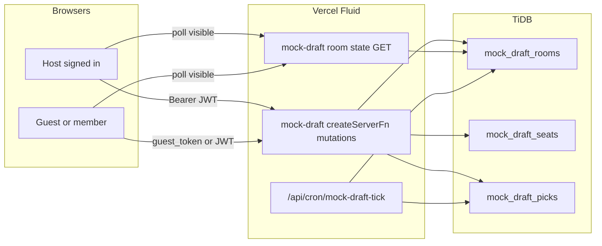

# Multiplayer Mock Draft Lobbies — Implementation Plan

**Decisions locked**

| Decision | Choice |
| --- | --- |
| Product | **Standalone practice rooms** — friends draft together; AI fills empty seats. Not native-league season drafts. |
| Create | **Logged-in host only** (Supabase auth) |
| Join | **Anyone with the room code** — signed-in users claim a seat with `user_id`; guests get a signed `guest_token` bound to that seat |
| Solo simulator | Keep `/mock-draft/setup` → `/mock-draft` as-is (client-only AI). Multiplayer is a parallel path. |
| Native live snake | **Out of scope.** Remains deferred in [`native-leagues-plan.md`](native-leagues-plan.md) Phase 2. Do not hitch mock rooms to `native_*` tables or `/league/$linkId/draft`. |
| Realtime | **Visibility-aware short polling** (same posture as native §6.6). No websockets / Supabase Realtime for TiDB state. |
| Data home | **TiDB** for live rooms + picks + short-lived completed snapshots; **Supabase** for auth only (optional thin “my past mocks” index later). |
| Completed boards | Freeze a compact JSON snapshot on complete; retain **7–14 days**; share via opaque token; CSV/JSON export client-side from that snapshot. |

Mobile already labels the entry point **“Mock Draft Lobby”** ([`MobileMockDraftCard`](../src/components/mobile/MobileHomeSections.tsx)) but it only links to solo setup. This plan makes that label real.

---

## 0. Where to host lobbies (options ranked)

TiDB Cloud allows **up to 5 free Starter instances** per org, each with its own **~50M RU/mo + 5 GiB** pool. That is the lever for “mocks don’t steal research RUs” — not moving live traffic onto Supabase.

### Ranked options

| Rank | Option | Live lobby + picks | Separate free pool? | Verdict |
| --- | --- | --- | --- | --- |
| **1 (recommended)** | **Dedicated TiDB Starter “D – Mocks”** | `mock_draft_*` only | **Yes** — own 50M RU | Best isolation; same code patterns as native; no auth-DB coupling |
| **2** | TiDB cluster **C with native** (`native_*` + `mock_draft_*`) | Shared instance | Shared 50M with native seasons | Fine if native traffic is still low; simpler ops (one extra cluster, not two) |
| **3** | Stay on **current** TiDB (research/synced) | Same instance as warehouse | No | OK for a quiet beta only; mocks compete with research RUs |
| **4** | **Upstash Redis / Vercel KV** live + TiDB snapshot | Ephemeral KV | Depends on KV free tier | Excellent for hot state later; new vendor + ops; not required for v1 |
| **Avoid** | **Supabase Postgres** for lobby/picks | Auth project DB | No — shares 500 MB / 5 GB egress / pause with Auth | Draft polls can starve or pause the whole site |
| **Avoid as SoT** | **Supabase Realtime** (Broadcast/Presence) alone | Push only | 200 conns / 2M msgs — separate caps, still need a DB | Fan-out layer at best; not authoritative picks/clock |

### Can we “use Supabase for the lobby + TiDB for mocks”?

**Not as the best design.** Useful split of responsibilities:

| Layer | Store |
| --- | --- |
| Sign-in / host identity | **Supabase Auth** (already) |
| Live seats, clock, picks, join codes | **TiDB** (prefer dedicated Starter D) |
| Optional “My saved mocks” list | Thin Supabase **or** TiDB index rows (low churn) |
| Realtime push | Skip v1; optional later Broadcast **on top of** TiDB authority |

Putting the **lobby itself** on Supabase (rows + poll or Realtime) while picks live on TiDB doubles write paths, still burns Supabase Free (egress/connections/pause), and does not give a cleaner free-tier story than a dedicated TiDB instance.

### Recommended path

1. **Ship v1** against a **dedicated TiDB Starter for mocks** (cluster **D**), env like `TIDB_MOCK_DATABASE_URL` / separate pool in [`tidb.ts`](../src/lib/tidb.ts) — wire only `mock_draft_*` there.
2. If you want fewer clusters short-term: put mocks on **C with native** when that cluster is created ([`free-tier-and-ux-scale-plan.md`](free-tier-and-ux-scale-plan.md) Phase 2); accept shared RU until mock volume justifies D.
3. Always: **coalesce polls** (`processMemo` / short private cache per `roomId`), visible-only refresh, room caps, TTL — so even a dedicated 50M pool lasts.
4. Keep Supabase out of the live pick path; guests never open a Supabase DB session for the room.
5. Revisit Redis/KV only if dedicated TiDB RUs still hurt under real concurrent rooms.

**Org quota note:** 5 free Starters total. Suggested map if fully split: A research · B synced/warehouse · C native · **D mocks** · (one spare). Don’t create D until mocks leave beta if A/B are still one instance — but **do** create D (or C) before mock poll traffic shares a stressed research cluster.

---

## 1. Current state

| Surface | Route | Authority | Notes |
| --- | --- | --- | --- |
| Solo Mock Draft | `/mock-draft/setup` → `/mock-draft` | Browser `useState` + `sessionStorage` config | AI loop + pick clock in [`mock-draft.tsx`](../src/routes/mock-draft.tsx); math in [`draft.ts`](../src/lib/draft.ts); AI in [`mock-ai.ts`](../src/lib/mock-ai.ts) |
| War Room | `/draft` | `localStorage` via [`use-draft.ts`](../src/hooks/use-draft.ts) | Manual board; no clock / AI |
| Native draft | `/league/$linkId/draft` | TiDB + Fluid | Offline commissioner assign; live clock deferred |

Reusable as-is: snake/linear `teamForPick`, roster helpers, `aiPick` / personas, `DraftBoard`, `PlayerList`, `MyTeamColumn`, `MockRecap`, setup form fields from [`mock-config.ts`](../src/lib/mock-config.ts).

Gaps for multiplayer: no room id, no shared picks, no server clock, no seat claims, no join-by-code, no conflict-safe pick endpoint.

---

## 2. Product UX

### 2.1 Entry

Extend setup into a **lobby hub** (desktop + mobile):

1. **Solo practice** — existing flow (unchanged).
2. **Host a room** — requires sign-in; configures league size, scoring, roster, snake/linear, pick timer (reuse `MockConfig` fields); host claims a draft slot; server returns `roomId` + short `joinCode`.
3. **Join with code** — open to anyone; enter code + display name; claim an open human seat (or wait if full).

Routes (proposed):

| Route | Purpose |
| --- | --- |
| `/mock-draft/setup` | Hub: Solo / Host / Join (keep current solo form; add mode switcher) |
| `/mock-draft/room/$roomId` | Lobby + live arena (same shell; lobby until host starts) |
| `/mock-draft/join?code=` | Deep link → claim seat → redirect to room |

Share link format: `/mock-draft/join?code=ABCD12` (code also shown large in lobby for verbal share).

### 2.2 Lobby (pre-start)

- Seat grid: slot 1…N with display name, `human` | `open` | `ai`, ready flag (optional v1: host-only start, no ready check).
- Host controls: kick seat, fill empty with AI / leave open until start (open seats become AI on start), change timer/settings until `status=live`, **Start Draft**.
- Non-hosts: rename self, leave seat, wait.
- Poll lobby state while visible (~2–3s).

### 2.3 Live draft

Reuse the solo arena chrome (Broadcast theme, board / players / my team tabs):

- Server owns picks, `current_pick`, `pick_deadline_at`, pause flag.
- Client shows countdown from `pick_deadline_at` (wall clock), not a local `setInterval` authority.
- On your turn: Draft buttons enabled; others greyed (`canDraft` already exists on `PlayerList`).
- Empty / AI seats: server AI tick (cron + pick-on-read) using existing `aiPick` personalities.
- Human timeout: `autoPickForUser`-equivalent on server (ADP / needs).
- Host: pause / resume / force-pick current seat.
- Complete → existing `MockRecap` fed from room picks (grades stay client-side; no season write).

### 2.4 Guest vs signed-in joiners

| Actor | Identity | Create room | Pick / claim seat |
| --- | --- | --- | --- |
| Host | Supabase `user_id` | Yes | Yes |
| Signed-in joiner | Supabase `user_id` | No | Yes |
| Guest joiner | Opaque `guest_id` + HMAC `guest_token` (httpOnly cookie or returned secret stored in `sessionStorage`) | No | Yes, token required |

Guests never hit `requireSupabaseAuth`. Join and pick endpoints accept either a valid Bearer session **or** a valid guest token for that `room_id` + `seat_id`.

Abuse caps: rate-limit join-by-code; max concurrent open rooms per host; room TTL (see §7).

---

## 3. Architecture



**Why Fluid for mutations:** credentials, guest-token verification, and `FOR UPDATE` pick serialization — same pattern as native league ops ([`native-league.functions.ts`](../src/lib/native-league.functions.ts)).

**Why not hitch to `native_*`:** rooms are ephemeral practice; no rosters/schedules/standings; different auth (guests); different lifecycle. Reuse **code** (`draft.ts`, `mock-ai.ts`, UI), not tables.

**Why polling:** free-tier plan already forbids tight Fluid loops and skips Realtime for TiDB. Lobby ~2–3s; live room ~1–2s while visible; backoff when hidden via [`page-visibility.ts`](../src/lib/page-visibility.ts) / `visibleRefetchInterval`. Draft clock advances via **pick-on-read timeout check** + light Actions cron (≤1/min globally), not 1s polls that write.

---

## 4. Data model (TiDB)

New tables (add to [`native-league-ddl.server.ts`](../src/lib/native-league-ddl.server.ts) sibling module e.g. `mock-draft-ddl.server.ts` + [`scripts/tidb/schema.sql`](../scripts/tidb/schema.sql); apply via existing TiDB migrate).

```
mock_draft_rooms
  id CHAR(36) PK
  join_code VARCHAR(8) UNIQUE NOT NULL     -- short share code
  host_user_id VARCHAR(36) NOT NULL
  status ENUM('lobby','live','paused','complete','expired') NOT NULL DEFAULT 'lobby'
  team_count TINYINT NOT NULL
  scoring_preset VARCHAR(16) NOT NULL      -- std|half|ppr
  roster_slots JSON NOT NULL
  draft_order_type ENUM('snake','linear') NOT NULL DEFAULT 'snake'
  pick_time_limit_sec INT NULL             -- null = no clock
  playoffs_start_week TINYINT NOT NULL DEFAULT 15
  draft_order JSON NULL                    -- optional custom slot order
  current_pick INT NOT NULL DEFAULT 0      -- 0 in lobby; 1..total when live
  pick_deadline_at DATETIME NULL
  settings_version INT NOT NULL DEFAULT 1
  expires_at DATETIME NOT NULL             -- hard TTL from create
  created_at / updated_at

mock_draft_seats
  room_id CHAR(36) NOT NULL
  seat_slot TINYINT NOT NULL                -- 1..team_count
  kind ENUM('open','human','ai') NOT NULL DEFAULT 'open'
  user_id VARCHAR(36) NULL                 -- signed-in claim
  guest_id VARCHAR(36) NULL                -- guest claim
  display_name VARCHAR(64) NOT NULL
  persona VARCHAR(32) NULL                 -- AI personality when kind=ai
  guest_token_hash CHAR(64) NULL           -- sha256 of guest secret
  connected_at DATETIME NULL              -- last successful poll/heartbeat
  PRIMARY KEY (room_id, seat_slot)
  UNIQUE KEY uq_mock_seat_user (room_id, user_id)
  UNIQUE KEY uq_mock_seat_guest (room_id, guest_id)

mock_draft_picks
  room_id CHAR(36) NOT NULL
  pick_number INT NOT NULL
  round TINYINT NOT NULL
  seat_slot TINYINT NOT NULL
  player_id VARCHAR(32) NOT NULL
  source ENUM('manager','autopick','ai','host_force') NOT NULL
  intent_id VARCHAR(36) NULL               -- client idempotency
  picked_at DATETIME NOT NULL
  PRIMARY KEY (room_id, pick_number)
  UNIQUE KEY uq_mock_pick_player (room_id, player_id)
  UNIQUE KEY uq_mock_pick_intent (room_id, intent_id)
```

No Supabase mirror. Catalog / ADP still from existing client players catalog + snap-cdn (no Fluid public reads).

---

## 5. Server API (Fluid `createServerFn`)

Module sketch: `src/lib/mock-draft-lobby.server.ts` + `src/lib/mock-draft-lobby.functions.ts`.

| RPC | Auth | Behavior |
| --- | --- | --- |
| `createMockDraftRoom` | `requireSupabaseAuth` | Insert room + seats; host seat = human; return `{ roomId, joinCode, seatSlot }` |
| `joinMockDraftRoom` | Optional auth | Resolve code → lock room → claim open seat; if no JWT, mint `guest_id` + token; return room + seat + token |
| `leaveMockDraftRoom` | JWT or guest token | Free seat if `lobby`; refuse mid-pick unless host reassigns |
| `updateMockDraftLobby` | Host JWT | Settings / fill AI / kick (lobby only) |
| `startMockDraft` | Host JWT | `status=live`, `current_pick=1`, set deadline, materialize open→ai |
| `getMockDraftRoom` | JWT or guest token for room | Snapshot: room, seats, picks, server `now`; **also** run pick-deadline expiry side effect (autopick) inside short transaction when live |
| `pickMockDraftPlayer` | JWT or guest token; must own current seat | `FOR UPDATE` room row; verify turn + player free; insert pick; advance cursor + deadline; idempotent on `intent_id` |
| `hostMockDraftControl` | Host JWT | pause / resume / force-pick / undo last (lobby rules TBD; v1: undo only before next pick lands) |

Cron: `GET /api/cron/mock-draft-tick` (`CRON_SECRET`) — scan `status IN ('live','paused')` with passed deadlines or stale AI turns; apply autopick/AI; expire rooms past `expires_at`.

Guest token: `HMAC-SHA256(roomId|guestId|seatSlot, MOCK_DRAFT_GUEST_SECRET)` (or sealed payload). Store only hash on seat; client keeps raw token.

---

## 6. Pick / clock correctness

Mirror native §6.4 without sharing tables:

1. `BEGIN`
2. `SELECT … FROM mock_draft_rooms WHERE id=? FOR UPDATE`
3. Assert `status=live`, actor owns `teamForPick(current_pick)`, player not in `mock_draft_picks`
4. Insert pick; `current_pick += 1`; set `pick_deadline_at = now + limit` (or null); if past total picks → `complete`
5. `COMMIT`
6. On conflict / wrong turn → `409` with fresh snapshot

**Timeout path (pick-on-read + cron):** if `now > pick_deadline_at` and still on that pick, server performs autopick/AI under the same lock, then returns updated snapshot. Clients never “decide” the pick locally.

AI seats: reuse [`aiPick`](../src/lib/mock-ai.ts) with seat `persona` (server import of shared pure helpers — already used by [`native-league-ai.server.ts`](../src/lib/native-league-ai.server.ts)).

---

## 7. Free-tier / lifecycle guardrails

| Rule | Value |
| --- | --- |
| Max rooms created per user / day | e.g. 10 |
| Max concurrent `lobby`+`live` rooms per host | e.g. 3 |
| Team count | 8–16 (match solo `TEAM_CHOICES`) |
| Room TTL | 6h from create; extend +2h while `live` and any seat polled in last 10m |
| Lobby poll | 2–3s visible only |
| Live poll | 1–2s visible only; pause when hidden |
| Cron tick | ≤1/min; also expiry sweep |
| Complete retention | On complete: write `result_snapshot` JSON; keep **7–14 days** for share/recap; purge picks+seats earlier if needed; cron deletes expired |
| Share links | Opaque `share_id` (not join code); read-only; no auth required |
| No public CDN of in-progress rooms | Private Fluid reads only (guest token or JWT) |

Do **not** fan out N Fluid calls per seat. One `getMockDraftRoom` returns the full snapshot.

---

## 8. Results, share, and export

On `status=complete`, server freezes a **compact snapshot** (settings, seat names, ordered picks with player id/name/pos/team, timestamps). Live polling stops; recap/share read the snapshot only.

| Feature | How | Limit impact |
| --- | --- | --- |
| **Recap page** | `/mock-draft/recap/$shareId` (or `?share=`) — read-only board + existing [`MockRecap`](../src/components/draft/MockRecap.tsx) | One Fluid GET; cacheable short private TTL |
| **Copy link** | Host/any seat copies share URL after complete (and optionally while live: “spectator link” = room id + read token — defer) | None |
| **Export JSON** | Download snapshot file from client | Zero server storage beyond snapshot |
| **Export CSV** | One row per pick: overall, round, seat, player, pos, team, source | Client-side |
| **Export text board** | Plaintext round-by-round for Discord/Reddit paste | Client-side |
| **Save to account** (phase 3+) | Signed-in only: insert thin Supabase or TiDB “my mocks” row keyed by `share_id` | Low churn; cap e.g. 20 saves/user |
| **Import to War Room** (phase 3+) | “Load my seat’s roster into War Room / sandbox” from snapshot — local only | No TiDB write |

Do **not** publish per-room JSON to the `snap-cdn` branch (orphan CDN is for shared public data, not private boards).

Schema add on `mock_draft_rooms` (or side table):

```
share_id CHAR(26) UNIQUE NULL      -- set at create or on complete
result_snapshot JSON NULL          -- frozen on complete
result_expires_at DATETIME NULL
```

---

## 9. Feature ideas from other mock platforms (prioritized)

Common elsewhere (FantasyPros Draft Wizard, Sleeper mocks, ESPN/Yahoo mocks, RTSports, etc.) mapped to us:

### Ship with multiplayer v1 (or immediately after live)
- **Private room + join code** (locked) + AI fillers
- **Pick queue** per seat (draft from queue / autopick from queue on timeout) — schema cousin of `native_draft_queues`
- **Host pause / force-pick / kick**
- **Pick clock** with visible deadline
- **Post-draft grades / recap** (already have `MockRecap`) + **share link + CSV/JSON**
- **Restart with same settings** (new room, same config)
- **Reach / value vs ADP** toggle (solo currently hides tags in live mock — offer “show ADP delta” for practice)

### Strong v1.5
- **Pre-draft rankings / watchlist sync** from War Room watch list
- **Positional needs / scarcity** strip (starters filled vs remaining ADP at position)
- **Spectator / late join read-only** after start
- **Custom draft order** drag in lobby (solo already has `customOrder` concepts in places)
- **Keeper pre-loads** (mark kept players before start — practice for keeper leagues)
- **Slow / hyper / no-timer** speeds (solo has speed already — host setting)

### Later / nice-to-have (do not block lobbies)
- Public open matchmaking lobby browser
- In-draft chat or emoji reactions
- In-draft trades
- Auction / salary-cap mocks
- Upload custom rankings CSV
- Historical “my mock archive” beyond 14-day snapshot
- Voice rooms
- ELO / leaderboards for public mocks

**Non-goals remain:** hitching results into native season rosters; Realtime; auction in v1.

---

## 10. UI implementation notes

- Preserve SiteNav + ScoreTicker via root layout; Broadcast tokens; no new theme.
- Split solo page logic: extract shared arena presentational pieces from [`mock-draft.tsx`](../src/routes/mock-draft.tsx) into something like `components/draft/MockDraftArena.tsx` that accepts either local controllers (solo) or room snapshot + mutation callbacks (multiplayer).
- Lobby seat strip above the arena (or replace players tab until start).
- Wire `PlayerModalHost` draft overrides to `pickMockDraftPlayer` with `intent_id` (uuid per click).
- Mobile: update `MobileMockDraftCard` to hub (Host / Join / Solo); room route under existing desktop shell first; `/m/mock-draft/...` can follow if needed.
- Auth gate on Host: reuse `AuthDialog`; Join stays open with display-name field.
- After complete: share URL + Export menu (JSON / CSV / plaintext) on recap.

---

## 11. Phased rollout

### Phase 0 — Schema + server skeleton
1. TiDB DDL for `mock_draft_*` (include `share_id` / `result_snapshot`); migrate path.
2. Server module: create / join / get (lobby only); guest token helpers; caps.
3. No UI yet beyond smoke via functions.

### Phase 1 — Lobby UX
1. Setup hub: Solo | Host | Join.
2. Room lobby page: seats, share code/link, host start, polling.
3. Deep link `/mock-draft/join?code=`.

### Phase 2 — Live multiplayer draft
1. `pickMockDraftPlayer` + turn gating wired to existing board/list.
2. Server clock + autopick on timeout; host pause/force.
3. AI fill for empty seats; complete → freeze snapshot → `MockRecap` + share/export.

### Phase 3 — Polish
1. Cron tick + expiry sweeper Actions workflow (live TTL + result retention).
2. Kick / reconnect / seat transfer; display names from profiles when signed in.
3. Pick queues; mobile lobby parity; rate-limit hardening; optional “save to account” / War Room import.
4. Basic observability (pick latency, active room count, RU proxies).

**Non-goals for v1:** auction, public open matchmaking browser, voice/chat, ranking/ELO, persisting mock results into native season leagues, hitching to native live snake, Supabase Realtime.

---

## 12. Explicit separation from native live snake

| | Mock lobby | Native live snake (later) |
| --- | --- | --- |
| Tables | `mock_draft_*` | `native_leagues` / `native_draft_picks` |
| After draft | Snapshot recap + share; TTL purge | Rosters + schedules + in-season |
| Guests | Allowed with token | Members only |
| Entry | `/mock-draft/...` | `/league/$linkId/draft` |

Shared libraries only: `draft.ts`, `mock-ai.ts`, draft UI components. When native live ships, it can copy the pick-lock / deadline / polling patterns from this plan — not the room rows.

---

## 13. Testing checklist

- Host create → join code works for signed-in and guest in two browsers.
- Double-click pick / retry with same `intent_id` → one pick.
- Two clients race different players on same turn → one `409`, board converges.
- Timer expiry → autopick without client write.
- AI seats advance without human action.
- Hidden tab stops polling; visible resume catches up via get snapshot.
- Room past `expires_at` rejects joins/picks.
- Solo `/mock-draft` path unchanged regression.
